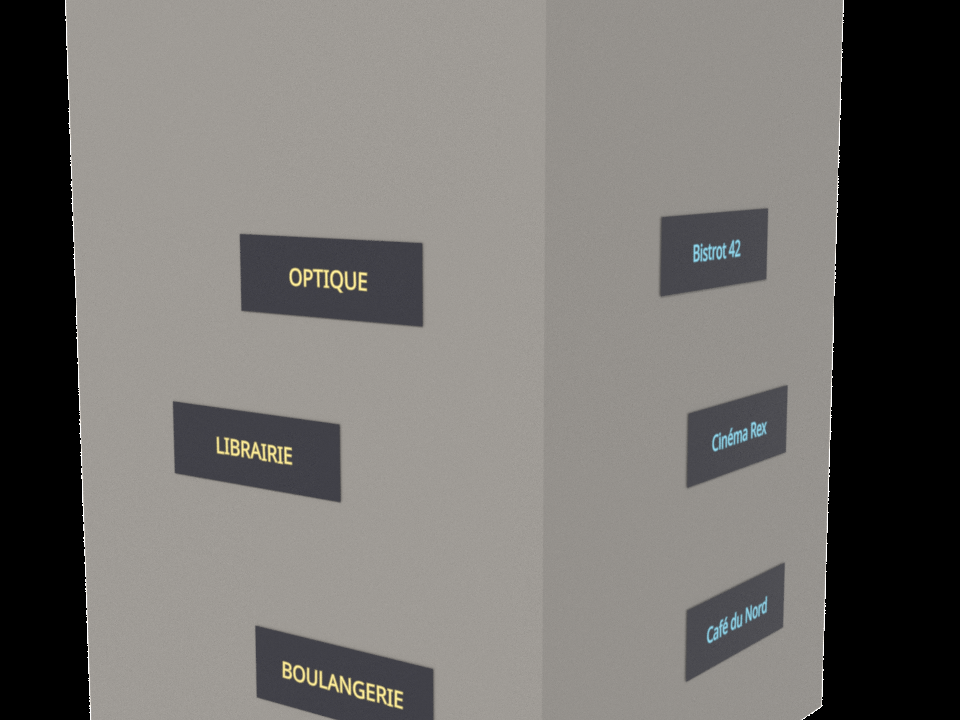
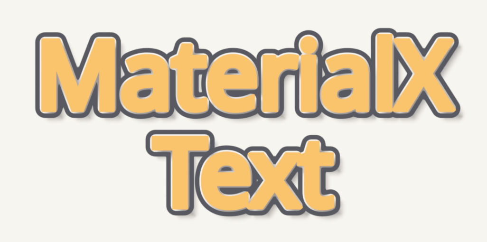

# MaterialX Text

Text drawn by a MaterialX shader, for Houdini 22 Solaris: Karma CPU, Karma XPU
and Cycles. Type the text in the node, or give every primitive its own text
from an attribute; the font is baked once into a multi-channel signed
distance field atlas, so letters stay sharp at any distance.



*One material on a building: each face carries its own text, colour and seed
as attributes; the MtlX Text Layout LOP turns them into the shader's data.*



*Outline and drop shadow from the node's own outputs, layered with two mix
nodes.*

## Features

- **Real typography**: proportional advances, pair kerning (GPOS / kern),
  tracking, word wrapping to a width, left / center / right / justify, font
  fallback across a list of fonts.
- **Sharp at any size**: multi-channel signed distance fields (MSDF) keep the
  corners; pixel-footprint antialiasing in Karma.
- **Overlapping letters**: up to four glyphs per 1/8 em along a line and
  overlapping lines, for negative tracking and tight leading.
- **Per letter**: outputs `character_id`, `word_id`, `line_id`, `glyph_uv`
  and `random`, plus random baseline, rotation, scale and missing letters.
- **Effects**: `sdf` and `sdf_round` (signed distances), `outline`, `shadow`,
  `bevel_height` (feed it to `heighttonormal` for a bevelled normal).
- **Per primitive**: every placement and look input (`text_size`,
  `text_origin`, `text_fg`, `text_seed`...) can come from an attribute.
- **Interactive**: a value change re-cooks in under 10 ms; Karma XPU compiles
  each wired output once, then keeps it in its disk cache.

## Requirements

- Houdini 22.0 (the Python package lives in `python3.13libs`).
- Karma CPU / XPU. Cycles through
  [cycles-for-houdini](https://github.com/adriendelmas/cycles-for-houdini)
  (patches 0137 and 0139).
- Font files of your own (`.ttf`, `.otf`, `.ttc`). No font is distributed.

## Install

```bash
git clone https://github.com/adriendelmas/MaterialX-Text.git
```

Point Houdini at the package file `packages/mtlx_text.json`, either with the
environment variable `HOUDINI_PACKAGE_DIR=<clone>/packages`, or with a package
file of your own in `$HOUDINI_USER_PREF_DIR/packages/`:

```json
{ "package_path": "<clone>/packages" }
```

Then build the HDAs once, with your own Houdini licence:

```bash
hython <clone>/build.py
```

## Use

1. In a Material Library or a MaterialX builder, add **MtlX Text** (MaterialX >
   Texture 2D). A new node starts with the system's default font.
2. Type in the *Text* box. Set the font, alignment, width and tracking on the
   same tab, and the placement in uv (origin, size in uv per em, aspect).
3. Wire `color` into a surface's base colour, or `mask` anywhere a float goes.
4. Look at it in a **Karma** viewport: Houdini's VK viewport does not draw
   custom MaterialX nodes.

A different text per primitive: put a string primvar `text` on the prims
(a primitive attribute in SOPs), assign the material, then add **MtlX Text
Layout** (LOP) after the assignment and point it at the material. A SOP
version does the same in SOPs.

Without Houdini's node, from a plain `.mtlx`: see
[examples/minimal](examples/minimal), and the command line:

```bash
hython -m mtlx_text bake --font a.ttf [--font b.otf] [--charset western] [--quality 48]
hython -m mtlx_text table --atlas a.exr --text "Line one\nLine two" --out table.exr
hython -m mtlx_text fonts
```

[docs/METHOD.md](docs/METHOD.md) is the reference: how it works, the data
contract for an HDA that drives it, every input and output, the limits.
[docs/PLAN.md](docs/PLAN.md) records the measurements behind the design.

## Limits

- No complex-script shaping (no HarfBuzz in Houdini): no ligatures, no
  right-to-left, no Devanagari. Tibetan works with fonts that draw their marks
  in place.
- Houdini's VK viewport does not draw it; use a Karma viewport.
- Cycles has no pixel footprint: antialiasing comes from its samples, or from
  *Edge Softness*.

## Tests

```bash
export MTLX_TEXT_TEST_FONTS="first.ttf;second.ttf"
hython tests/test_layout.py <scratch_dir>
hython tests/test_render.py <scratch_dir> cpu,xpu,cycles
hython tests/test_lop.py <scratch_dir> cpu,xpu
hython tests/test_features.py <scratch_dir> cpu,xpu
```

Every render is compared pixel by pixel with a numpy evaluation of the same
nodegraph (`tests/mtlx_eval.py`).

## Licence

Apache License 2.0, like MaterialX: see [LICENSE](LICENSE) and
[NOTICE](NOTICE) for the work this builds on (msdfgen's method, a fontTools
module).
